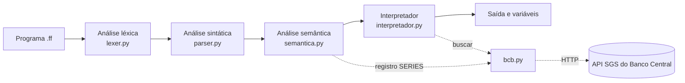

# FinFlow

Linguagem de domínio específico (DSL) para modelagem de operações financeiras, com tipagem de grandezas e acesso a dados reais do Banco Central do Brasil.


-informational)

[](Docs/artigo_finflow.pdf)

## Sumário

- [Sobre o projeto](#sobre-o-projeto)
- [Funcionalidades](#funcionalidades)
- [Início rápido](#início-rápido)
- [Instalação](#instalação)
- [Uso](#uso)
- [A linguagem FinFlow](#a-linguagem-finflow)
- [Exemplos incluídos](#exemplos-incluídos)
- [Arquitetura](#arquitetura)
- [Tratamento de erros](#tratamento-de-erros)
- [Testes](#testes)
- [Estrutura do projeto](#estrutura-do-projeto)
- [Limitações conhecidas](#limitações-conhecidas)
- [Solução de problemas](#solução-de-problemas)
- [Documentação](#documentação)
- [Autores](#autores)

## Sobre o projeto

A FinFlow é uma linguagem para escrever cálculos financeiros de forma curta e verificável. Seu sistema de tipos distingue valores monetários (`moeda`) de taxas (`percentual`) e rejeita, antes da execução, operações sem sentido financeiro, como somar um valor em reais com uma taxa.

O projeto foi desenvolvido para resolver três problemas:

1. **Erros de unidade silenciosos.** Em linguagens de propósito geral, `saldo + taxa` é válido e produz um resultado incorreto. Na FinFlow, esse erro é detectado na análise semântica, com a linha e a causa.
2. **Trabalho manual com dados macroeconômicos.** O comando `buscar("ipca", 2025)` obtém o valor acumulado diretamente da API pública do Banco Central, já como `percentual`. As séries mensais são agregadas por composição (produto de `1 + taxa`), e não por soma.
3. **Transparência para estudo.** A interface web exibe cada fase do compilador (tokens, árvore sintática, tipos e consultas à rede), o que permite observar como um programa é traduzido e executado.

O sistema é um compilador com front-end completo (análise léxica, sintática e semântica) e execução por interpretação direta da árvore sintática. Não há geração de código de máquina ou de outra linguagem.

Trabalho prático final da disciplina de Teoria da Computação e Compiladores, da FHO (Fundação Hermínio Ometto).

## Funcionalidades

- Tipos `moeda`, `percentual`, `inteiro` e `texto`, com regras explícitas de composição.
- Aritmética decimal exata (`decimal.Decimal`) com arredondamento financeiro (meio para cima): `0.10 + 0.20` é exatamente `0.30`.
- Escopo de blocos: variáveis declaradas dentro de `se`, `para` e `escolha` deixam de existir ao fim do bloco.
- Comandos de declaração, atribuição, condicional (`se`/`senao`), repetição (`para`), seleção (`escolha`) e saída (`imprimir`).
- Operadores aritméticos, de comparação e lógicos (`e`, `ou`, `nao`), com avaliação em curto-circuito.
- Acesso a oito séries do Banco Central por meio de `buscar`.
- Interface web com editor e passo a passo do processamento.
- Uso por linha de comando e como biblioteca Python.
- Mensagens de erro com fase e linha de origem.

## Início rápido

Requer Python 3.10 ou superior e acesso à internet para os programas que usam `buscar`.

```bash
git clone https://github.com/Scaglia05/finflow.git
cd finflow
pip install -r requirements.txt
python main.py
```

O último comando abre a interface web em `http://127.0.0.1:8000`. Escolha um exemplo, clique em **Executar** (ou use Ctrl+Enter) e consulte o resultado.

## Instalação

### Pré-requisitos

| Requisito | Versão | Finalidade |
|---|---|---|
| Python | 3.10 ou superior | execução do compilador |
| `ply` | 3.11 ou superior | geração do analisador léxico e sintático |
| `requests` | 2.28 ou superior | consultas à API do Banco Central |
| `pytest` | 7.0 ou superior | execução dos testes |

### Passo a passo

```bash
git clone https://github.com/Scaglia05/finflow.git
cd finflow
python -m venv venv
```

Ative o ambiente virtual:

```bash
# Windows
venv\Scripts\activate

# Linux ou macOS
source venv/bin/activate
```

Instale as dependências:

```bash
pip install -r requirements.txt
```

## Uso

### Interface web

```bash
python main.py
```

A interface permite escrever ou escolher um programa, executá-lo e inspecionar as etapas: análise léxica, sintática e semântica, consulta ao Banco Central (com a URL e o tempo de cada requisição) e execução, além da tabela de variáveis finais. O botão **Rodar todos os exemplos** executa todos os arquivos de `exemplos/`.

Para alterar o endereço ou a porta, use o servidor diretamente:

```bash
python playground.py --port 8080 --sem-navegador
```

### Linha de comando

```bash
python main.py --console                 # executa todos os exemplos
python main.py exemplos/juros.ff         # executa um programa
python main.py --series                  # lista as séries do Banco Central
```

Ao executar um único programa, o código de saída é 0 em caso de sucesso e 1 em caso de erro.

### Biblioteca Python

```python
from finflow import rodar_finflow, buscar_serie_bc, rodar_finflow_com_dados_bc

# Executa um programa FinFlow
rodar_finflow('imprimir(buscar("ipca", 2025));')

# Obtém uma série pelo código do SGS (acumulado composto, em fração decimal)
selic = buscar_serie_bc(4390, "01/01/2025", "31/12/2025")

# Injeta variáveis já declaradas no programa
rodar_finflow_com_dados_bc(
    'imprimir(valor + valor * taxa);',
    {'valor': ('moeda', 1000.0), 'taxa': ('percentual', selic)},
)
```

## A linguagem FinFlow

### Exemplo

```
moeda saldo = 1000.00;
percentual taxa = 5%;
moeda saldo_final = saldo + saldo * taxa;

se saldo_final > 1000 entao {
    imprimir("cresceu");
} senao {
    imprimir("nao cresceu");
}

imprimir(saldo_final);
```

Saída:

```
cresceu
R$ 1050.00
```

Comentários começam com `#` e terminam no fim da linha. Literais com ponto decimal (`1000.00`) são `moeda`; literais seguidos de `%` (`5%`, equivalente a `0.05`) são `percentual`; literais sem ponto são `inteiro`.

### Comandos

| Comando | Exemplo |
|---|---|
| Declaração | `moeda saldo = 1000.00;` |
| Atribuição | `saldo = saldo + 10.00;` |
| Condicional | `se saldo > 500 entao { ... } senao { ... }` |
| Repetição | `para i = 1 ate 5 faca { ... }` |
| Seleção | `escolha n { caso 1: ... padrao: ... }` |
| Saída | `imprimir(saldo);` |
| Dado do Banco Central | `buscar("ipca", 2025)` ou `buscar("ipca", 2020, 2025)` |

A repetição `para` tem limites inclusivos. Em `escolha`, apenas o primeiro `caso` correspondente é executado; o `padrao` é executado se nenhum corresponder.

### Operadores e precedência

Da menor para a maior precedência: `ou`, `e`, `nao`, comparações (`==`, `!=`, `>`, `<`, `>=`, `<=`), `+` e `-`, `*` e `/`. Os operadores `e` e `ou` avaliam o operando direito somente quando necessário.

### Regras de composição de tipos

| Par de tipos | `+` e `-` | `*` | `/` |
|---|---|---|---|
| `moeda`, `moeda` | `moeda` | rejeitado | `percentual` |
| `percentual`, `percentual` | `percentual` | `percentual` | `percentual` |
| `inteiro`, `inteiro` | `inteiro` | `inteiro` | `inteiro` |
| `moeda`, `inteiro` | `moeda` | `moeda` | `moeda` |
| `percentual`, `inteiro` | `percentual` | `percentual` | `percentual` |
| `moeda`, `percentual` | rejeitado | `moeda` | `moeda` |

Para aplicar uma taxa a um valor, utilize `valor + valor * taxa`. A divisão entre dois `inteiro` é inteira; a divisão por zero provoca erro de execução. Condições de `se` e operandos de `e`, `ou` e `nao` devem ser comparações ou expressões lógicas.

Em declarações e atribuições, o valor deve ter o tipo da variável, com uma única exceção: um `inteiro` pode ser atribuído a `moeda` (`moeda m = 5;` vale `R$ 5.00`). O contrário é rejeitado, para não truncar centavos (`inteiro n = 10.50;` é erro), e um `inteiro` não vira `percentual` (`percentual p = 5;` é erro; use `5%`).

### Escopo

Variáveis declaradas no nível do programa são globais e visíveis em todos os blocos. Variáveis declaradas dentro de um bloco (`se`, `senao`, `para`, `caso`, `padrao`) existem apenas até o fim dele, e a variável de controle do `para` existe apenas no laço; usá-las depois é erro de escopo. Não há sombreamento: declarar, em um bloco interno, um nome já visível é erro. Um mesmo nome pode ser reutilizado em blocos distintos, desde que com o mesmo tipo.

```
inteiro soma = 0;
para i = 1 ate 3 faca {
    inteiro dobro = i * 2;   # existe apenas dentro do laço
    soma = soma + dobro;
}
imprimir(soma);              # 12
imprimir(i);                 # erro: variavel 'i' fora do escopo
```

### Dados do Banco Central

A expressão `buscar("serie", ano)` retorna o valor da série no ano indicado. O ano pode ser uma variável, inclusive a de um laço `para`.

| Série | Tipo | Conteúdo | Código SGS |
|---|---|---|---|
| `selic` | `percentual` | Selic acumulada (composta) no período | 4390 |
| `cdi` | `percentual` | CDI acumulado (composto) | 4391 |
| `ipca` | `percentual` | IPCA (inflação) acumulado | 433 |
| `igpm` | `percentual` | IGP-M acumulado | 189 |
| `poupanca` | `percentual` | Rendimento acumulado da poupança | 196 |
| `meta_selic` | `percentual` | Meta Selic (% a.a.) no fim do período | 432 |
| `dolar` | `moeda` | Última cotação de venda do dólar no período | 1 |
| `euro` | `moeda` | Última cotação de venda do euro no período | 21619 |

Séries mensais são agregadas por composição: `acumulado = produto(1 + taxa_mes) - 1`. A série 432 do SGS é a meta da Selic, e não a Selic mensal; por isso `selic` utiliza a série 4390. Consultas com mais de 10 anos são divididas em janelas, conforme o limite da API. As requisições têm tempo limite de 30 segundos, até 3 tentativas e cache durante a execução.

## Exemplos incluídos

| Arquivo | Descrição | Internet |
|---|---|---|
| `juros.ff` | Aplica uma taxa de 5% sobre R$ 1.000,00 e informa se o saldo cresceu. | Não |
| `para_escolha.ff` | Soma os inteiros de 1 a 5 com um laço e classifica uma categoria com `escolha`. | Não |
| `juros_comp.ff` | Aplica 1% ao mês durante 12 meses sobre R$ 1.000,00 com um laço `para` e testa uma meta. | Não |
| `categoria_desp.ff` | Associa uma categoria de despesa a um limite com `escolha` e compara o gasto ao limite. | Não |
| `meta_poupanca.ff` | Simula aportes mensais de R$ 250,00 com rendimento de 2% ao mês durante seis meses e verifica uma meta. | Não |
| `erro_tipo.ff` | Soma `moeda` com `percentual`; é rejeitado de propósito para demonstrar a análise semântica. | Não |
| `rendimento.ff` | Compara R$ 10.000,00 aplicados em 2025 na Selic e na poupança, calcula o ganho real da Selic descontada a inflação (IPCA) e informa qual opção foi melhor. | Sim |
| `inflacao_por_ano.ff` | Busca o IPCA de cada ano de 2020 a 2025 e calcula o poder de compra atual de R$ 1.000,00. | Sim |
| `cambio.ff` | Busca o dólar e o euro de 2025 e classifica o câmbio como calmo ou pressionado. | Sim |

Os valores impressos pelos exemplos que usam `buscar` dependem do dado publicado pelo Banco Central no momento da execução.

## Arquitetura



| Módulo | Responsabilidade |
|---|---|
| `finflow/lexer.py` | Converte o código em tokens (PLY); palavras reservadas resolvidas por tabela hash. |
| `finflow/parser.py` | Gramática LALR(1) com 34 regras de produção (incluindo a regra aumentada) e 83 estados, sem conflitos; produz a árvore sintática como tuplas Python. |
| `finflow/semantica.py` | Tabela de símbolos e verificação de tipos, com tabelas explícitas de pares compatíveis. |
| `finflow/interpretador.py` | Execução por percurso da árvore (*tree-walking*). |
| `finflow/bcb.py` | Camada desacoplada de acesso à API do Banco Central: registro de séries, requisições, janelas, tentativas, cache e agregação. |
| `playground.py`, `web/index.html` | Servidor HTTP local e interface web. |

Decisões de projeto relevantes: a análise semântica ocorre antes da execução, de modo que um erro de tipo impede qualquer comando ou requisição de rede; o compilador conhece apenas o registro `SERIES`, e a rede só é acessada em tempo de execução, o que permite testar o compilador sem internet.

## Tratamento de erros

| Fase | Exceção | Exemplo de mensagem |
|---|---|---|
| Léxica | `SyntaxError` | `Lexema invalido: '@' na linha 1` |
| Sintática | `SyntaxError` | `Erro sintatico: token inesperado 'FIM_CMD' (';') na linha 1` |
| Semântica | `ErroSemantico` | `[linha 3] erro de tipo: nao e possivel somar 'moeda' com 'percentual' diretamente` |
| Execução | `ErroExecucao` | `[linha 1] divisao por zero` |
| Banco Central | `ErroBCB` | `falha ao consultar a serie 433: sem conexao com a API do Banco Central` |

Série desconhecida e tipo incompatível em `buscar` são detectados na análise semântica. Ano futuro, API indisponível e período sem dados geram `ErroBCB` em execução.

## Testes

```bash
python -m pytest testes -v
```

A suíte possui 111 testes: 110 executam sem acesso à rede (a requisição HTTP é substituída por dados fixos) e 1 é um teste ao vivo, desativado por padrão. Eles cobrem o léxico, o parser (inclusive erros), a análise semântica (tipos, coerção e escopo), a aritmética decimal, o interpretador, a camada do Banco Central (códigos HTTP, tentativas, cache e respostas malformadas), a linha de comando e o servidor web. A cobertura medida é de 99% (linhas e ramos); os ramos restantes são defesas inalcançáveis.

Para incluir o teste ao vivo:

```bash
# Linux ou macOS
FINFLOW_LIVE=1 python -m pytest testes -v

# Windows (PowerShell)
$env:FINFLOW_LIVE=1; python -m pytest testes -v
```

Para medir a cobertura:

```bash
pip install coverage
python -m coverage run --branch --source=finflow,playground,main -m pytest testes
python -m coverage report -m
```

### Reprodução dos experimentos do artigo

O script `tools/experimentos.py` regenera os números do artigo a partir da implementação atual: regras de produção numeradas, efeito da tabela de precedência (conflitos e árvores), traço do parser, caracterização dos exemplos e desempenho por fase.

```bash
python tools/experimentos.py tudo
```

Os tempos dependem da máquina; os demais valores são determinísticos.

## Estrutura do projeto

```
.
├── finflow/              # pacote do compilador
│   ├── lexer.py
│   ├── parser.py
│   ├── semantica.py
│   ├── interpretador.py
│   └── bcb.py            # integração com a API do Banco Central
├── exemplos/             # programas .ff
├── testes/               # testes automatizados (pytest)
├── tools/
│   └── experimentos.py   # reproduz os experimentos do artigo
├── web/index.html        # interface web
├── Docs/
│   └── artigo_finflow.pdf   # artigo científico (versão final)
├── main.py               # interface web e linha de comando
├── playground.py         # servidor da interface web
└── requirements.txt
```

## Limitações conhecidas

- Um mesmo nome só pode ser reutilizado em blocos distintos com o mesmo tipo, pois o tipo de cada nome é registrado uma única vez para a formatação da saída.
- Não há conversão explícita entre tipos (por exemplo, de `moeda` para `inteiro`) nem sombreamento de variáveis.
- A sintaxe não inclui sinal unário (`-5`), listas, funções definidas pelo usuário nem sequências de escape em textos. O `senao` exige bloco entre chaves, e `texto` não participa de aritmética.
- Programas com `buscar` dependem da disponibilidade da API do Banco Central. No ano corrente, o período é limitado à data atual, e as séries de cotação retornam apenas a última cotação.
- A interface web destina-se ao uso local, sem autenticação.

## Solução de problemas

| Sintoma | Causa provável | Ação |
|---|---|---|
| `sem conexao com a API do Banco Central` | Sem internet ou conexão bloqueada | Verificar a rede e o firewall; os exemplos sem `buscar` funcionam offline. |
| `TypeError: unsupported operand type(s) for \|` ao importar `finflow` | Python anterior à 3.10 | Atualizar para Python 3.10 ou superior. |
| `ModuleNotFoundError: No module named 'ply'` | Dependências não instaladas | Executar `pip install -r requirements.txt`. |
| Porta 8000 em uso | Outro processo na porta | Executar `python playground.py --port 8080`. |

## Documentação

O artigo científico que descreve o projeto está disponível em PDF:

[](Docs/artigo_finflow.pdf)

Ele contém a fundamentação teórica, a especificação formal da linguagem, a implementação e os resultados.

## Autores

- Guilherme Augusto Scaglia (RA 111598)
- João Pedro Denardo (RA 113036)
- Pedro Henrique Oliveira de Souza (RA 113364)

Engenharia de Computação, Fundação Hermínio Ometto (FHO), Araras, SP.
